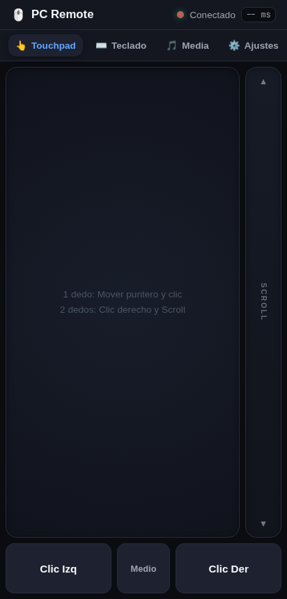
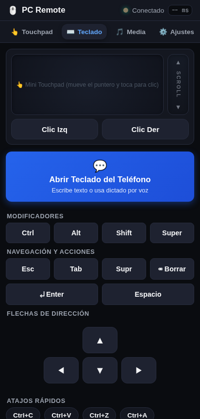

# 📱 Phone Control — Secure PC Remote Desktop

<p align="center">
  
  &nbsp;&nbsp;&nbsp;&nbsp;&nbsp;&nbsp;
  
</p>

<p align="center">
  <a href="LICENSE"></a>
  
  
  
  
</p>

Turn any smartphone (iOS / Android) into an ultra-low-latency wireless trackpad, keyboard, and media controller for your Linux PC — without installing any apps on your phone.

Scan a QR code from your terminal and pair instantly.

```
Smartphone Browser  ──(WebSocket via Wi-Fi)──►  Node.js Backend  ──(Pipe)──►  uinput C Driver  ──►  Linux Kernel (/dev/uinput)
                                                                                                      │
                                                                                                      ▼
                                                                                             Hyprland / Wayland / X11
```

---

## ✨ Features

- **📱 Zero App Installation**: Works on any mobile browser (Safari, Chrome, Firefox) as a full PWA.
- **⚡ Sub-millisecond Latency**: Direct kernel input simulation via `/dev/uinput` written in C.
- **🎯 Dynamic Touchpad**:
  - 1 finger: Smooth cursor glide with velocity acceleration curve.
  - 1 finger tap: Left click.
  - 2 fingers tap: Right click.
  - 2 fingers scroll: Fluid horizontal and vertical mouse wheel scrolling.
  - Long press hold: Drag and drop (windows, text selection).
  - Physical buttons: Left, Middle, and Right mouse buttons.
- **🎛️ Dual-Mode Keyboard & Mini-Touchpad**:
  - Move the cursor and click directly from the **Teclado** tab without switching tabs.
  - Dedicated **Fast Scroll Rail**: Slide one finger along the vertical edge for high-speed scrolling with tactile haptic ticks.
- **⌨️ Native Mobile Keyboard**:
  - Use your phone's native keyboard (auto-complete, accents, emojis, and **speech-to-text dictation**).
  - Quick modifiers: `Ctrl`, `Alt`, `Shift`, `Super` (Windows key) with sticky toggle states.
  - Symmetrical D-Pad (`▲`, `◀`, `▼`, `▶`).
  - Direct shortcuts: `Ctrl+C`, `Ctrl+V`, `Ctrl+Z`, `Ctrl+A`, `Alt+Tab`, `Close Window`.
- **🎵 Multimedia & Presentation**:
  - Hardware volume controls (`wpctl` / `amixer`).
  - Media playback controls (`playerctl`): Play/Pause, Next, Prev.
  - Presentation mode: Next/Prev slide (`PageUp` / `PageDown`).
- **🔋 Battery & Screen Saver**:
  - Uses the **Screen Wake Lock API** so your phone screen never turns off while using it.
  - Tactile haptic feedback (`navigator.vibrate`) on clicks and key presses.
  - Responsive dark OLED interface (<2% phone battery usage).

---

## 🛡️ Security Architecture (Hardened by Default)

Built following modern cybersecurity audit principles (Anthropic Cybersecurity Skills & Cloudflare Security Audit practices):

1. **🔒 Cryptographic Timing-Safe Authentication**:
   - Each session generates an entropy-backed hex token.
   - Verified via `crypto.timingSafeEqual` to eliminate side-channel timing attacks.
   - Unauthorized attempts reject all input emulation.
2. **🚫 Cross-Site WebSocket Hijacking (CSWSH) Defense**:
   - Validates the `Origin` header on every WebSocket upgrade. Malicious websites cannot connect in the background.
3. **🧱 LAN-Only Firewall Integration**:
   - Includes `manage-firewall.sh` which restricts the port strictly to your local subnet (e.g. `192.168.1.0/24`), blocking external traffic.
4. **🛑 IP Rate-Limiting & Brute-Force Shield**:
   - Enforces a threshold of 5 failed attempts before temporarily blacklisting an IP address.
5. **🛡️ Safe Memory & Process Isolation**:
   - The C driver uses **0 heap allocations (`malloc`)** — zero memory leaks possible.
   - All input coordinates and keycodes are strictly bounds-checked and clamped.
   - Subprocesses (`wpctl`, `playerctl`) use `execFile` without shell interpolation, preventing shell injection vulnerabilities.
   - Uses zero CPU cycles when idle (blocks cleanly on standard input).
6. **🌐 Dynamic Port & Multi-Interface Resolution**:
   - Automatically detects active ports and avoids collisions (`EADDRINUSE`).
   - Surfaces all available network interfaces (Wi-Fi, Ethernet, Hotspot, Tailscale).

---

## 🚀 Quick Start

### 1. Requirements

- **Linux** (Arch / CachyOS, Ubuntu / Debian, Fedora, openSUSE, etc.)
- **Node.js** v18+ and `pnpm` (or `npm`)
- `gcc` or `clang`, `make`

### 2. Setup (One-time command)

```bash
git clone https://github.com/programadorisgod/phone-control.git
cd phone-control
./setup.sh
```

*(This compiles the C driver, installs lightweight Node.js dependencies, configures the `/dev/uinput` udev rule, and sets the LAN-only firewall).*

### 3. Start

```bash
./start.sh
```

A QR code and local URL will appear in your terminal. Point your smartphone's camera at the terminal to connect!

---

## ⚙️ Configuration & Settings

All settings can be customized in real-time from the **Ajustes** tab on your phone:
- **Pointer Sensitivity**: 0.4x to 2.5x
- **Scroll Sensitivity**: 0.5x to 2.0x
- **Dynamic Acceleration**: On / Off
- **Natural Scrolling**: Inverted scroll On / Off
- **Haptic Vibration**: On / Off
- **Wake Lock (Keep Screen Awake)**: On / Off

---

## 🧪 Testing & Verification

Run the memory and sanitizer checks locally:

```bash
# Compile driver with AddressSanitizer and UndefinedBehaviorSanitizer
gcc -fsanitize=address,undefined -O2 -Wall -Wextra -o backend/uinput_driver backend/uinput_driver.c

# Test status and firewall rules
./manage-firewall.sh status
```

---

## 📄 License

MIT License. Free for personal and commercial use.
